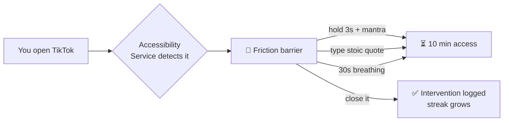

# 📵 Unscroll


> **Anti-dopamine screen blocker.** Every time you open a distracting app, Unscroll stands in the way — hold, breathe or type your way back to focus.

Stop losing hours to TikTok, Reels and Shorts. Unscroll adds a real **friction barrier** between impulse and feed: no silent blocking, just enough resistance for your brain to opt out.

---

## 🧠 How it works



The barrier is enforced by an `AccessibilityService` (Android's equivalent of Apple's DeviceActivity) that watches foreground apps and launches a full-screen overlay — fully on-device, zero data collection.

## ✨ Features

| | Feature | Detail |
|--|--|--|
| 🚧 | **Friction barrier** | Full-screen overlay over any blocked app |
| 🧘 | **3 challenge types** | Hold + mantra · Stoic typing · 30s guided breathing |
| 🎯 | **Daily goal** | Pick how much time you want back; progress tracked daily |
| 🔥 | **Streaks** | Consecutive days of showing up |
| 📊 | **Time reclaimed** | Estimated hours saved from logged interventions |
| 🔒 | **Hard paywall** | Weekly subscription gates the dashboard ($4.99/wk · 3-day trial) |
| 🛰️ | **Remote paywalls** | Superwall-ready: flip one constant to enable A/B testing |
| 🌍 | **Localization** | English (default) + Portuguese BR |
| 🕶️ | **Dark by design** | Always-dark UI built for late-night scroll urges |

## 🏗 Architecture

```
app/src/main/java/com/unscroll/app/
├── core/          # AccessibilityService + friction overlay (the moat)
├── onboarding/    # 6-screen psychological funnel w/ progress bar
├── paywall/       # Native paywall + Superwall gatekeeper
├── billing/       # Play Billing 7 wrapper (weekly sub + trial)
├── dashboard/     # Home, goals, app picker, permissions, settings
├── data/          # PrefsRepository + BlockedAppsStore (StateFlow-driven)
└── navigation/    # NavHost w/ conditional entry routes
```

## 🚀 Getting started

**Requirements:** Android Studio · JDK 17 · device/emulator on API 26+

```bash
git clone https://github.com/bonamigod86/Unscroll-app.git
# open in Android Studio → Sync → Run ▶
```

or CLI-only:

```bash
./gradlew :app:assembleDebug   # → app/build/outputs/apk/debug/
```

### Test checklist (debug builds)

1. Onboarding funnel → paywall → *"Continue in test mode"* bypasses billing without Play Console setup
2. Choose your daily goal + friction challenge
3. Settings → enable the accessibility service
4. Block YouTube → open it → the barrier strikes

## 💳 Paywall modes

| Mode | When | Behavior |
|--|--|--|
| **Native** (default) | `SuperwallConfig.API_KEY` is empty | Compose paywall backed by Google Play Billing |
| **Superwall remote** | API key set | Remote paywalls, A/B testing, gated feature blocks |

To go remote: paste your key in [`SuperwallConfig.kt`](app/src/main/java/com/unscroll/app/billing/SuperwallConfig.kt), create the `onboarding_complete` placement in the dashboard, set Feature Gating = **Gated**, and link the `unscroll_weekly` product.

## 🗺 Roadmap

- [ ] Strict mode (no temporary unlock after N failures)
- [ ] Usage stats integration for real screen-time deltas
- [x] Home-screen widget — "time reclaimed today", total black
- [ ] Quick tiles
- [ ] Adaptive friction escalation presets (shipped as Smart Friction v1)
- [ ] iOS sibling via shared design system

---

Built with Kotlin + Jetpack Compose. Your attention is the product everywhere else — here, it's yours again.
